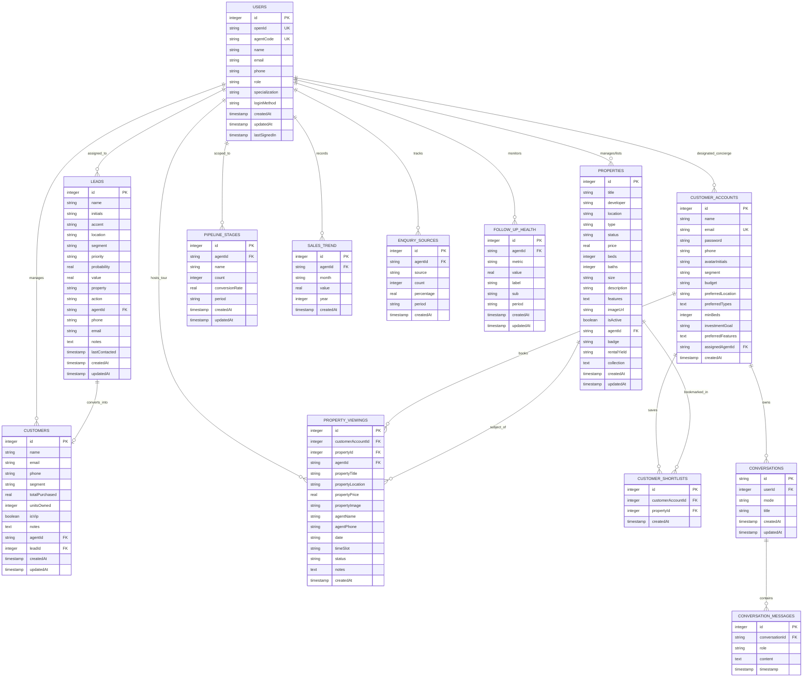

# Comprehensive Entity Relationship Diagram (ERD) & DDL Specification

## 1. Visual Entity Relationship Diagram (Mermaid)



---

## 2. Complete SQL DDL Schema

```sql
-- =============================================================================
-- 1. USERS & AGENTS
-- =============================================================================
CREATE TABLE IF NOT EXISTS users (
    id INTEGER PRIMARY KEY AUTOINCREMENT,
    open_id TEXT NOT NULL UNIQUE,
    agent_code TEXT UNIQUE,
    name TEXT,
    email TEXT,
    phone TEXT,
    role TEXT NOT NULL DEFAULT 'agent', -- 'agent', 'admin', 'user'
    specialization TEXT,
    login_method TEXT,
    created_at TIMESTAMP NOT NULL DEFAULT CURRENT_TIMESTAMP,
    updated_at TIMESTAMP NOT NULL DEFAULT CURRENT_TIMESTAMP,
    last_signed_in TIMESTAMP NOT NULL DEFAULT CURRENT_TIMESTAMP
);

-- =============================================================================
-- 2. PROPERTIES CATALOG
-- =============================================================================
CREATE TABLE IF NOT EXISTS properties (
    id INTEGER PRIMARY KEY AUTOINCREMENT,
    title TEXT NOT NULL,
    developer TEXT NOT NULL,
    location TEXT NOT NULL,
    type TEXT NOT NULL,
    status TEXT NOT NULL,
    price REAL NOT NULL,
    beds INTEGER NOT NULL DEFAULT 0,
    baths INTEGER NOT NULL DEFAULT 0,
    size TEXT NOT NULL,
    description TEXT,
    features TEXT, -- JSON array
    image_url TEXT,
    is_active BOOLEAN NOT NULL DEFAULT 1,
    agent_id TEXT REFERENCES users(agent_code) ON DELETE SET NULL,
    badge TEXT,
    rental_yield TEXT,
    collection TEXT, -- JSON array
    created_at TIMESTAMP NOT NULL DEFAULT CURRENT_TIMESTAMP,
    updated_at TIMESTAMP NOT NULL DEFAULT CURRENT_TIMESTAMP
);

-- =============================================================================
-- 3. SALES LEADS
-- =============================================================================
CREATE TABLE IF NOT EXISTS leads (
    id INTEGER PRIMARY KEY AUTOINCREMENT,
    name TEXT NOT NULL,
    initials TEXT NOT NULL,
    accent TEXT NOT NULL,
    location TEXT NOT NULL,
    segment TEXT NOT NULL,
    priority TEXT NOT NULL DEFAULT 'Medium', -- 'High', 'Medium', 'Low'
    probability REAL NOT NULL,
    value REAL NOT NULL,
    property TEXT NOT NULL,
    action TEXT NOT NULL,
    agent_id TEXT NOT NULL DEFAULT 'hannah' REFERENCES users(agent_code) ON DELETE CASCADE,
    phone TEXT,
    email TEXT,
    notes TEXT,
    last_contacted TIMESTAMP,
    created_at TIMESTAMP NOT NULL DEFAULT CURRENT_TIMESTAMP,
    updated_at TIMESTAMP NOT NULL DEFAULT CURRENT_TIMESTAMP
);

-- =============================================================================
-- 4. CONFIRMED CUSTOMERS (CRM)
-- =============================================================================
CREATE TABLE IF NOT EXISTS customers (
    id INTEGER PRIMARY KEY AUTOINCREMENT,
    name TEXT NOT NULL,
    email TEXT,
    phone TEXT,
    segment TEXT NOT NULL,
    total_purchased REAL NOT NULL DEFAULT 0,
    units_owned INTEGER NOT NULL DEFAULT 0,
    is_vip BOOLEAN NOT NULL DEFAULT 0,
    notes TEXT,
    agent_id TEXT REFERENCES users(agent_code) ON DELETE SET NULL,
    lead_id INTEGER REFERENCES leads(id) ON DELETE SET NULL,
    created_at TIMESTAMP NOT NULL DEFAULT CURRENT_TIMESTAMP,
    updated_at TIMESTAMP NOT NULL DEFAULT CURRENT_TIMESTAMP
);

-- =============================================================================
-- 5. CUSTOMER ACCOUNTS (SELF-SERVICE BUYER PROFILES & AI PREFERENCES)
-- =============================================================================
CREATE TABLE IF NOT EXISTS customer_accounts (
    id INTEGER PRIMARY KEY AUTOINCREMENT,
    name TEXT NOT NULL,
    email TEXT NOT NULL UNIQUE,
    password TEXT NOT NULL,
    phone TEXT,
    avatar_initials TEXT NOT NULL,
    segment TEXT NOT NULL,
    budget TEXT,
    preferred_location TEXT,
    preferred_types TEXT, -- e.g. "Condominium,Penthouse"
    min_beds INTEGER DEFAULT 0,
    investment_goal TEXT, -- e.g. "High Rental Yield", "Capital Appreciation"
    preferred_features TEXT, -- e.g. "Private Lift,Sky Pool"
    assigned_agent_id TEXT REFERENCES users(agent_code) ON DELETE SET NULL,
    created_at TIMESTAMP NOT NULL DEFAULT CURRENT_TIMESTAMP
);

-- =============================================================================
-- 6. CUSTOMER SHORTLISTS (M:N JOIN TABLE)
-- =============================================================================
CREATE TABLE IF NOT EXISTS customer_shortlists (
    id INTEGER PRIMARY KEY AUTOINCREMENT,
    customer_account_id INTEGER NOT NULL REFERENCES customer_accounts(id) ON DELETE CASCADE,
    property_id INTEGER NOT NULL REFERENCES properties(id) ON DELETE CASCADE,
    created_at TIMESTAMP NOT NULL DEFAULT CURRENT_TIMESTAMP,
    UNIQUE(customer_account_id, property_id)
);

-- =============================================================================
-- 7. PROPERTY VIEWINGS (TOUR TRACKER)
-- =============================================================================
CREATE TABLE IF NOT EXISTS property_viewings (
    id INTEGER PRIMARY KEY AUTOINCREMENT,
    customer_account_id INTEGER NOT NULL REFERENCES customer_accounts(id) ON DELETE CASCADE,
    property_id INTEGER NOT NULL REFERENCES properties(id) ON DELETE CASCADE,
    agent_id TEXT NOT NULL REFERENCES users(agent_code),
    property_title TEXT NOT NULL,
    property_location TEXT NOT NULL,
    property_price REAL NOT NULL,
    property_image TEXT,
    agent_name TEXT NOT NULL,
    agent_phone TEXT NOT NULL,
    date TEXT NOT NULL,
    time_slot TEXT NOT NULL,
    status TEXT NOT NULL DEFAULT 'Confirmed', -- 'Confirmed', 'Pending', 'Cancelled', 'Completed'
    notes TEXT,
    created_at TIMESTAMP NOT NULL DEFAULT CURRENT_TIMESTAMP
);

-- =============================================================================
-- 8. AI CONVERSATIONS & MULTI-SESSION STORAGE
-- =============================================================================
CREATE TABLE IF NOT EXISTS conversations (
    id TEXT PRIMARY KEY,
    user_id TEXT, -- User ID or Customer Account ID (NULL for guest sessions)
    mode TEXT NOT NULL DEFAULT 'agent', -- 'agent' or 'customer'
    title TEXT NOT NULL DEFAULT 'New Conversation',
    created_at TIMESTAMP NOT NULL DEFAULT CURRENT_TIMESTAMP,
    updated_at TIMESTAMP NOT NULL DEFAULT CURRENT_TIMESTAMP
);

CREATE TABLE IF NOT EXISTS conversation_messages (
    id INTEGER PRIMARY KEY AUTOINCREMENT,
    conversation_id TEXT NOT NULL REFERENCES conversations(id) ON DELETE CASCADE,
    role TEXT NOT NULL, -- 'user' | 'assistant'
    content TEXT NOT NULL,
    timestamp TIMESTAMP NOT NULL DEFAULT CURRENT_TIMESTAMP
);

-- =============================================================================
-- 9. ANALYTICS: PIPELINE FUNNEL STAGES
-- =============================================================================
CREATE TABLE IF NOT EXISTS pipeline_stages (
    id INTEGER PRIMARY KEY AUTOINCREMENT,
    agent_id TEXT REFERENCES users(agent_code) ON DELETE CASCADE,
    name TEXT NOT NULL,
    count INTEGER NOT NULL DEFAULT 0,
    conversion_rate REAL NOT NULL DEFAULT 0,
    period TEXT NOT NULL DEFAULT 'current',
    created_at TIMESTAMP NOT NULL DEFAULT CURRENT_TIMESTAMP,
    updated_at TIMESTAMP NOT NULL DEFAULT CURRENT_TIMESTAMP
);

-- =============================================================================
-- 10. ANALYTICS: SALES TRENDS (MONTHLY REVENUE)
-- =============================================================================
CREATE TABLE IF NOT EXISTS sales_trend (
    id INTEGER PRIMARY KEY AUTOINCREMENT,
    agent_id TEXT REFERENCES users(agent_code) ON DELETE CASCADE,
    month TEXT NOT NULL,
    value REAL NOT NULL,
    year INTEGER NOT NULL,
    created_at TIMESTAMP NOT NULL DEFAULT CURRENT_TIMESTAMP
);

-- =============================================================================
-- 11. ANALYTICS: ENQUIRY ACQUISITION SOURCES
-- =============================================================================
CREATE TABLE IF NOT EXISTS enquiry_sources (
    id INTEGER PRIMARY KEY AUTOINCREMENT,
    agent_id TEXT REFERENCES users(agent_code) ON DELETE CASCADE,
    source TEXT NOT NULL,
    count INTEGER NOT NULL DEFAULT 0,
    percentage REAL NOT NULL DEFAULT 0,
    period TEXT NOT NULL DEFAULT 'current',
    created_at TIMESTAMP NOT NULL DEFAULT CURRENT_TIMESTAMP
);

-- =============================================================================
-- 12. ANALYTICS: FOLLOW-UP HEALTH & SLA PERFORMANCE
-- =============================================================================
CREATE TABLE IF NOT EXISTS follow_up_health (
    id INTEGER PRIMARY KEY AUTOINCREMENT,
    agent_id TEXT REFERENCES users(agent_code) ON DELETE CASCADE,
    metric TEXT NOT NULL,
    value REAL NOT NULL DEFAULT 0,
    label TEXT NOT NULL,
    sub TEXT,
    period TEXT NOT NULL DEFAULT 'current',
    created_at TIMESTAMP NOT NULL DEFAULT CURRENT_TIMESTAMP,
    updated_at TIMESTAMP NOT NULL DEFAULT CURRENT_TIMESTAMP
);
```
